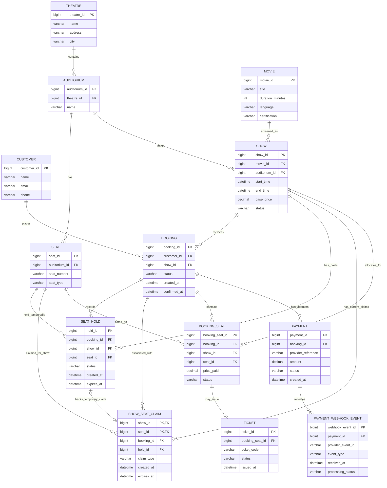

# BookMyShow — Entity Relationship Diagram




## Entity Responsibilities

| Entity | Responsibility |
|---|---|
| `CUSTOMER` | Stores customer information. |
| `THEATRE` | Represents a cinema location. |
| `AUDITORIUM` | Represents a screen or hall within a theatre. |
| `SEAT` | Stores the physical seat layout for an auditorium. |
| `MOVIE` | Stores movie metadata. |
| `SHOW` | Schedules a movie in an auditorium for a specified time interval. |
| `BOOKING` | Groups a customer's booking attempt for one show. |
| `SEAT_HOLD` | Records temporary seat-hold attempts, expiry times, and outcomes. |
| `SHOW_SEAT_CLAIM` | Tracks current ownership of a show-seat pair and prevents conflicting claims. |
| `BOOKING_SEAT` | Records allocated seats, their booking associations, historical status, and prices. |
| `PAYMENT` | Records payment attempts associated with a booking. |
| `PAYMENT_WEBHOOK_EVENT` | Records provider events for idempotent processing and auditing. |
| `TICKET` | Represents the ticket issued for an individual allocated seat. |

## Core Relationships

- A theatre contains multiple auditoriums.
- An auditorium contains physical seats and can host multiple shows at different times.
- Each show screens one movie in one auditorium.
- A customer can have multiple bookings, and a booking is associated with one show.
- A booking can have multiple temporary seat holds.
- A show-seat pair can have at most one current claim.
- A booking can have multiple allocated seats and multiple payment attempts.
- A payment can receive multiple webhook events.
- Each allocated seat can have at most one ticket in this model.

## Current Seat Ownership

`SHOW_SEAT_CLAIM` is the authoritative table for current seat ownership.

Its composite primary key is:

`(show_id, seat_id)`

Consequently, two rows cannot represent separate current claims for the same seat at the same show.

A claim can represent either:

- `HOLD`: a temporary claim that expires after five minutes unless payment succeeds and the booking is confirmed.
- `CONFIRMED`: a claim representing a confirmed seat allocation.

When a temporary hold expires or a booking is cancelled, the current claim is released. Historical hold and booking-seat records remain available for auditing and reporting.

Claim acquisition, confirmation, expiry, and release must be coordinated transactionally. An operation must verify that it still owns the claim before releasing or changing it.

## Integrity Requirements

1. A seat belongs to one auditorium.
2. A show belongs to one auditorium and screens one movie.
3. Every held or allocated seat must belong to the auditorium used by its show.
4. A booking, its seat holds, and its seat allocations must refer to the same show.
5. Only one current claim can exist for a `(show_id, seat_id)` pair.
6. Multi-seat holds must be atomic: acquire all requested seats or retain none of the claims acquired by that attempt.
7. Expired holds must not block new claims.
8. Historical holds and allocations must not prevent a seat from being booked again after its claim has been released.
9. A late payment success must not reclaim a seat that has already been allocated elsewhere.
10. Duplicate payment webhook events must not apply a payment state transition more than once.
11. Shows scheduled in the same auditorium must not overlap.
12. Tickets must only be issued for valid confirmed allocations.

## Physical-Design Notes

This is the logical ER model, not the final MySQL DDL.

- `BOOKING_SEAT` includes `show_id` to make the show-seat relationship explicit. A composite foreign-key strategy must ensure that it matches the show associated with the booking.
- `SHOW_SEAT_CLAIM` uses `(show_id, seat_id)` as its primary key to enforce uniqueness of current ownership.
- The schema must ensure that the claim's booking belongs to the same show and that any referenced hold matches the claimed seat and booking.
- `SEAT_HOLD` and `BOOKING_SEAT` preserve history; `SHOW_SEAT_CLAIM` represents current ownership.
- Unique constraints, foreign keys, indexes, transaction boundaries, locking, and expiry processing will be finalized during physical schema design.
- Payment-provider event identifiers must be unique within the appropriate provider scope.
- `BOOKING_SEAT.price_paid` preserves the price charged at booking time, independently of later show-price changes.
```

### Important note on the diagram

Mermaid expresses the main entities and relationships, but it does not fully express every constraint described in the notes. We'll define those precisely in Step 3.

In particular, the final schema must enforce consistency between `booking_id`, `show_id`, `seat_id`, and `hold_id` wherever those identifiers appear together.

---